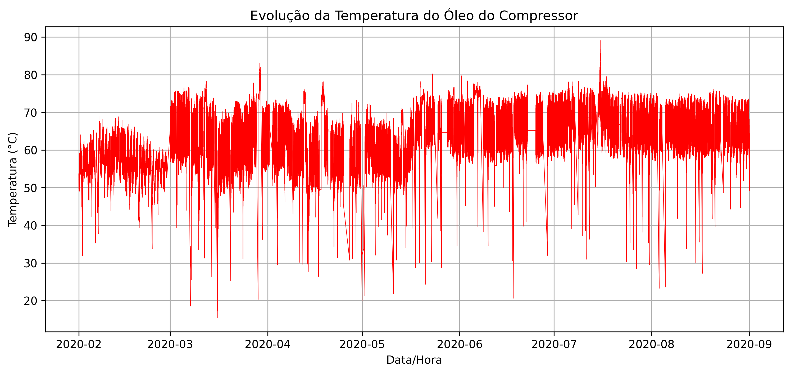
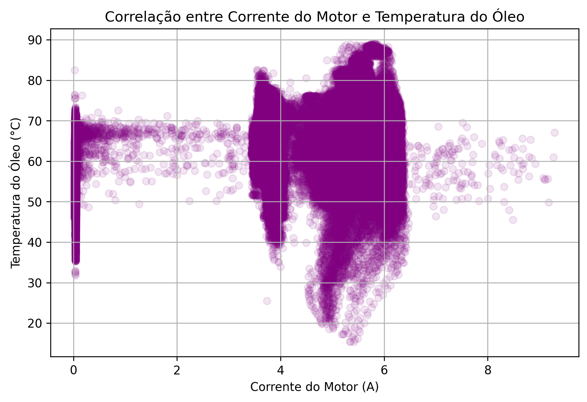
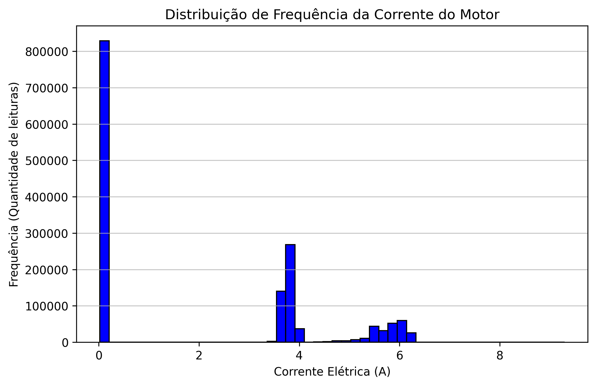

# Análise de Dados: Compressor Industrial (Dataset MetroPT-3)

## 📋 Visão Geral
Projeto de análise exploratória e tratamento de dados de sensores de um compressor industrial (MetroPT-3). O objetivo é identificar padrões de falha, criar visualizações que auxiliem na manutenção preditiva e demonstrar um pipeline de limpeza e análise de dados.

## 🎯 Problema de Negócio
Em ambientes industriais, paradas não planejadas geram altos custos. A análise dos dados de sensores (temperatura, pressão, vibração) permite antecipar falhas e otimizar a estratégia de manutenção.

## 🛠️ Tecnologias e Ferramentas
- **Linguagem:** Python 3
- **Manipulação de Dados:** Pandas, NumPy
- **Visualização:** Matplotlib
- **Ambiente:** Google Colab / Jupyter Notebook

## 📊 Metodologia
1.  **Entendimento dos Dados:** Análise inicial do dataset MetroPT-3 e dicionário de variáveis.
2.  **Limpeza e Tratamento:** Tratamento de valores nulos, conversão de tipos de dados (tratamento de strings com vírgulas para float) e preparação da série temporal.
3.  **Análise Exploratória (EDA):** Estatísticas descritivas e correlação entre variáveis.
4.  **Visualização:** Criação de gráficos de linha, histogramas e boxplots para identificar anomalias.

## 📈 Resultados Obtidos

O projeto permitiu identificar padrões cruciais de operação e falha do equipamento. Abaixo estão as principais visualizações geradas:

**Figura 1: Série Temporal de Temperatura e Pressão**
Identificação visual de picos que coincidem com os períodos de falha do compressor.

**Figura 2: Dispersão de Variáveis**
Análise de correlação entre os sensores operacionais, evidenciando a relação entre as variáveis em condições normais e anômalas.

**Figura 3: Comportamento da Corrente do Motor**
Acompanhamento do esforço operacional do motor, auxiliando na identificação de sobrecargas antes da parada do equipamento.

- **Insight de Qualidade de Dados:** Tratamento bem-sucedido de dados brutos corrompidos (ajuste de formato decimal e preenchimento de nulos), garantindo a integridade da série temporal.
- **Entregável:** O notebook `01_analise_exploratoria.ipynb` contém todo o código comentado e os gráficos interativos.
## 🚀 Como Executar
1.  Clone o repositório.
2.  Instale as dependências: `pip install pandas numpy matplotlib`
3.  Abra o notebook `01_analise_exploratoria.ipynb` no Jupyter ou faça o upload no Google Colab.
4.  Baixe o dataset original no link abaixo e coloque na pasta `data/`.

## 📂 Estrutura do Repositório
- `data/`: Instruções para download do dataset original (devido ao tamanho).
- `notebooks/`: Notebook com a análise completa.
- `reports/figures/`: Gráficos exportados.

## 🔗 Fonte dos Dados
Dataset público MetroPT-3, disponível no [UCI Machine Learning Repository](https://archive.ics.uci.edu/ml/datasets/MetroPT3).
